I like computers, particularly the parts of computing that most people don't have to think about.

I'm interested in how software works underneath its abstractions, from memory management and operating systems to graphics rendering and game engines. I enjoy building things from scratch, experimenting with different approaches, and occasionally making things more complicated than necessary just to understand them. There's something satisfying about knowing not just what works, but why it works.

Based in Eswatini, studying at UNESWA.

```
0000-3FFF  languages   Rust, Zig, C, C++, Python, Kotlin, JavaScript, GLSL
4000-7FFF  building    an NES emulator in Rust, a Game Boy one next,
                       an operating system, a language and the VM under it
8000-9FFF  graphics    raycasting, software rendering, shaders
A000-BFFF  offline     Fate, Frieren, Naruto, Re:Zero, Mushoku Tensei,
                       Tokyo Ghoul, and game soundtracks
FF00-FF7F  io          see below
```

My old repositories are private now. This is a clean start, and the new ones will show up here as I write them.

[Twitter](https://twitter.com/stedeus) · [Instagram](https://instagram.com/deusfps) · [YouTube](https://www.youtube.com/c/33deus) · [Spotify](https://open.spotify.com/user/31gp3ekfbpke5il7w3co7lczglra)
